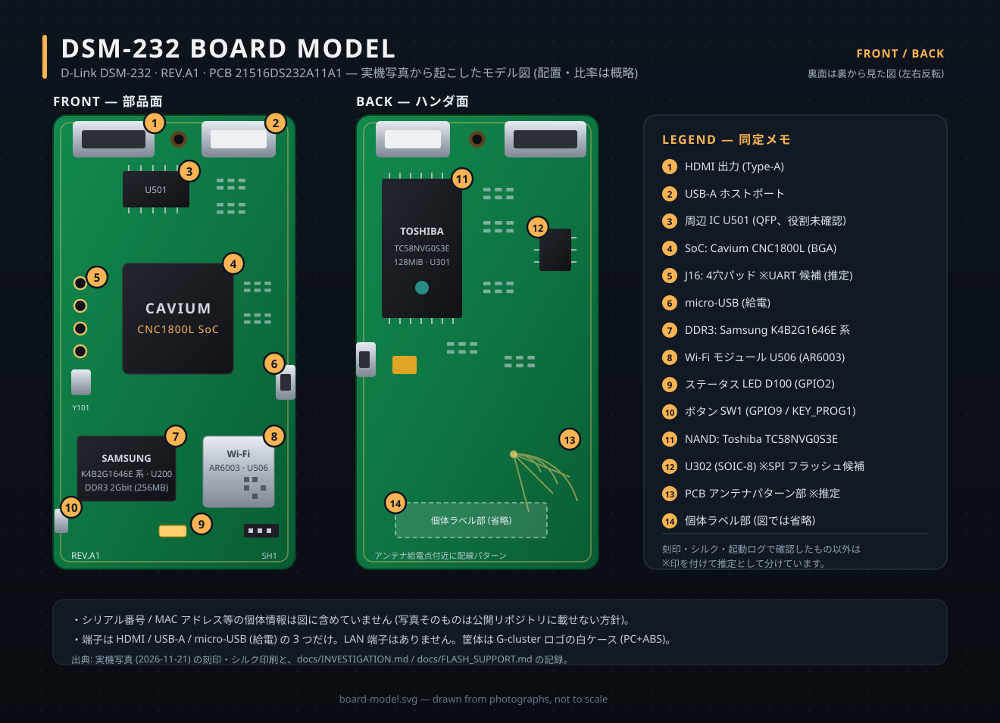

# dsm232

D-Link **DSM-232** (rev A1、Celestial **CNC1800L** SoC) に **Linux 7.2 + Alpine Linux** を載せる作業リポジトリ。

純正ファームウェアは Linux 2.6.32 + ベンダー BSP の時代のものです。本リポジトリは、GPL 公開ソースと実機ダンプの解析を根拠に、mainline に近い形でドライバ・DT バインディング・DTS を新規に書き、**USB メモリから起動して HDMI にコンソールが出る**ところまでを実機で確認しています。フラッシュには何も書きません。

> 同名の別製品にご注意ください。本リポジトリの DSM-232 は D-Link のメディアプレーヤー (G-cluster 系) で、Trimble の DGPS 受信機「DSM 232」とは無関係です。

- ライセンス: [GPL-3.0](LICENSE)
- 既定ブランチ: `main` / 最新確認コミット時点でも開発継続中
- カーネル: Linux **v7.2** (`v7.2` タグ + パッチ 28 本)
- ブートローダ: 純正 U-Boot 2011.06 で起動するのが既定経路。別途、U-Boot **v2026.07** への移植パッチも同梱 (実機未検証、下記参照)

## ボードモデル (実機写真から起こした図)



実機 (REV.A1、基板シルク `21516DS232A11A1`) を分解して撮影した写真から起こしたモデル図です。写真で読み取れた刻印・シルクはそのまま反映し、推定には ※印を付けました。写真そのものではなく図にしたのは、シリアル番号・MAC アドレス等の個体情報を公開リポジトリに載せないためです。

写真から同定できた主な搭載部品:

| 部品 | 刻印 / シルク | 備考 |
|---|---|---|
| SoC | CAVIUM ロゴ (BGA、基板中央) | CNC1800L |
| DDR3 | Samsung `K4B2G1646E` 系 (U200) | 2Gbit = 256MB。カーネル設定の 256MB と一致 |
| NAND | Toshiba `TC58NVG0S3E` (U301、裏面 TSOP) | 128MiB。型番は起動ログでも確認済み ([docs/FLASH_SUPPORT.md](docs/FLASH_SUPPORT.md)) |
| Wi-Fi | シールドモジュール (U506) | AR6003 (SDIO)。裏面下部に PCB アンテナパターン部あり (推定) |
| 周辺 IC | U501 (QFP、HDMI 側) | 役割は未確認 |
| デバッグ候補 | J16 (4穴パッド、SoC 左脇、TP6 / TP9 / TP10 併記) | UART 端子の候補 (写真からの推定、要実機確認) |
| SPI 候補 | U302 (SOIC-8、裏面) | SPI フラッシュの候補 (写真からの推定) |

## ハードウェア

| 項目 | 内容 |
|---|---|
| 製品 | D-Link DSM-232 rev A1 |
| SoC | Celestial Semiconductor (後に Cavium) CNC1800L、SDK コードネーム "Tiga Mini" |
| CPU | ARM1176 系 (Linux 側 `MACH_CELESTIAL_CNC1800L`、`ARCH_CELESTIAL`) |
| RAM | 256MB (先頭 `0x00000000`)。ただし Linux に渡すのは `0x0`〜`0x08900000` の **137MB のみ** (`mem=137M`)。それより上はベンダー FW がフレームバッファ / ビデオ / オーディオ / demux 用に使う領域 |
| フラッシュ | 並列 NAND (Celestial NAND コントローラ) + SPI フラッシュ 128KiB (miniloader + U-Boot env、読み出し専用で公開) |
| UART | DesignWare APB UART ×2。コンソールは UART0 `0x801F1000`、115200 8N1 (`ttyS0`) |
| USB | EHCI `0x80200000` + OHCI `0x80210000` (ホスト) |
| Wi-Fi | SDIO 接続の Atheros **AR6003** hw2.1.1 (`ath6kl_sdio`、SDIO コントローラ `0x80290000`)。MAC アドレスは U-Boot env の `wifiaddr` から取得 |
| 表示 | HDMI (Silicon Image 系 TX `0x80400000` + Display Feeder `0xB1800000`)。DRM tiny ドライバで 1080p60 まで。CEC アダプタ (`/dev/cec0`) 付き |
| GPIO | CNC1800L GPIO 41 本。ステータス LED = GPIO2、フロントボタン = GPIO9 (`KEY_PROG1`) |
| その他 | ウォッチドッグ (DesignWare WDT、reboot に使用)、タイマー ×2、クロック / リセット / ピンマックス |
| LAN | 端子なし (未対応ではなく、ハードウェアに存在しない) |

詳細なレジスタ・調査根拠は [docs/INVESTIGATION.md](docs/INVESTIGATION.md) と [docs/LINUX_PERIPHERALS.md](docs/LINUX_PERIPHERALS.md) を参照してください。

## 対応状況 (実機確認済み / 未検証を正直に分けています)

| 機能 | 状態 | 備考 |
|---|---|---|
| USB メモリから起動 (UART 不要) | ✅ 実機確認済み | 純正 FW が一度起動してから USB の Linux に切り替わる。手順は [docs/USB_BOOT_ALPINE.md](docs/USB_BOOT_ALPINE.md) |
| HDMI コンソール (DRM) | ✅ 実機確認済み | EDID 読取、1080p60 / 1080p50 / 720p60 / 480p / 1024×768、XRGB8888 / RGB565 |
| HDCP 1.x 認証 | ✅ 実機確認済み | 認証しないとテレビ側が絵を出さない。1〜2 回目で成功するのが通常 |
| HDMI ホットプラグ | ✅ 実機確認済み | 抜き差し・テレビの入力切替のどちらでも画面が復帰。HPD レベルで判定 |
| USB ホスト + ext4 rootfs | ✅ 実機確認済み | 起動した USB メモリが `sda` として認識され、第 2 パーティション (ext4、ラベル `dsm232root`) を root にして起動 |
| Wi-Fi (AR6003) | ✅ 実機確認済み | `wpa_supplicant` + `udhcpc` で DHCP 取得、インターネットへの ping、起動時自動接続。省電力は既定で OFF (遅延が安定するため) |
| SSH / NTP | ✅ 実機確認済み | dropbear が起動時から応答。ログインは HDMI (`tty1`) と UART (`ttyS0`) |
| reboot / poweroff | ✅ 実機確認済み | `reboot` は WDT 経由で再起動。`poweroff` は `System halted` で停止するだけで**電源は切れない**ので、停止後に AC アダプタを抜くこと |
| GPIO / LED / ボタン | ✅ 実機確認済み | LED 点灯、ボタンで `KEY_PROG1` の押下 / 解放イベント |
| クロック / リセット / ピンマックス | ✅ 実機確認済み | パッチ 0006、0007、0016 |
| CEC | ⚠️ 部分確認 | 論理アドレス取得と送信は動作。接続した PC モニターが CEC 非対応だったため、CEC 対応テレビとの通信は未検証 |
| NAND / SPI フラッシュ読出し | ✅ 実機確認済み (読出しのみ) | ECC の旧方式 (HW Hamming 互換) / 新方式 (標準 soft BCH) を DT で切替。詳細は [docs/FLASH_SUPPORT.md](docs/FLASH_SUPPORT.md)。**書き込みは行わない方針** |
| 試験カーネルの kexec 起動 | ✅ 利用可能 | USB のカーネルを書き換えずに試せる。失敗したら電源を入れ直せば元に戻る。手順は LINUX_PERIPHERALS.md §8 |
| U-Boot 2026.07 移植 | ❌ 実機未検証 | ビルド成功のみ。フラッシュへ書く手順も未実施 (下記「安全上の注意」参照) |
| HDMI 音声 | ❌ 未対応 | 音声は DSP ファーム + バイナリライブラリ (`libcsaud.a`) 経由で、解析が必要なため保留 |
| I2C | ❌ 未対応 / 接続先なしの可能性 | I2C0 / I2C1 とも応答確認できず。DSM-232 では何も接続されていない可能性が高い (調査記録は LINUX_PERIPHERALS.md §9) |
| SPI DMA | ❌ 未対応 | SPI フラッシュが 128KiB 読出し専用で利点がないため |

## クイックスタート: USB から起動して HDMI にコンソールを出す

必要なのは **Docker とネット接続だけ** です (ホスト側のクロスコンパイラは不要)。

```bash
git clone https://github.com/tsuji-riya/dsm232.git
cd dsm232
./build-usb.sh
```

`build-usb.sh` は Docker イメージをビルドし、その中でカーネル → Alpine → USB イメージの順に全部を作ります。

出来上がるもの:

| 成果物 | 内容 |
|---|---|
| `out/dsm232-usb.img` | 512MB の完成イメージ (MBR)。第 1 パーティション = FAT16 63MB (カーネル / initramfs / `factory.img`)、第 2 パーティション = ext4 448MB (Alpine rootfs、ラベル `dsm232root`) |
| `out/usb/` | FAT 側に入るファイル一式 (`uImage`、`uInitrd`、`boot.scr`、`cameo_factory/factory.img`、任意で `wpa_supplicant.conf`) |
| `out/rootfs.tar.gz` | Alpine rootfs の tarball |

USB メモリへの書き込みと起動:

```bash
# ⚠️ 指定したデバイスの中身は全部消えます。デバイス名を必ず目視で確認してください
sudo dd if=out/dsm232-usb.img of=/dev/sdX bs=4M conv=fsync status=progress
```

1. 書いた USB メモリを DSM-232 に挿したまま電源を入れる
2. 純正 FW が一度起動してから USB の Linux に切り替わる (実機確認済み、UART 不要)
3. HDMI にコンソールが出て、HDMI (`tty1`) / UART (`ttyS0`) からログインできる。Wi-Fi 設定を置いてあれば SSH でも入れる

詳細・解像度の変え方・UART を使う代替手順・切り分け方法: [docs/USB_BOOT_ALPINE.md](docs/USB_BOOT_ALPINE.md)

### Wi-Fi を使う場合 (任意)

`alpine/wpa_supplicant.conf` を置いてからビルドすると、イメージの FAT 側に同梱され、起動時に `/etc` へ取り込まれて自動接続します。このファイルは `.gitignore` 済みで、**認証情報をコミットしない**ための配慮です。同様に `alpine/authorized_keys` と、ベンダー board data の `alpine/bdata.bin` (再配布不可のためリポジトリに含めていない) も git 管理外です。`bdata.bin` が無い場合は `linux-firmware` の汎用 board data にフォールバックします。

## 個別ビルド

Docker を使わず、部品ごとに作ることもできます。

### Linux 7.2

```bash
# 要: gcc-arm-linux-gnueabi, u-boot-tools, bc flex bison libssl-dev
./linux-7.2/build.sh            # 既定の取得先は ../../linux-src
./linux-7.2/build.sh /path/to/linux-src
```

Linux `v7.2` タグを取得し、パッチ `0001`〜`0028` を upstream 形式 (DT バインディング / ドライバ / DTS / defconfig を分離) で順に適用して、`uImage` (zImage + DTB 連結) を作ります。純正 U-Boot は DTB を渡せないため `ARM_APPENDED_DTB` を使います。パッチの一覧と内容は [linux-7.2/README.md](linux-7.2/README.md) を参照してください。

### Alpine Linux (initramfs + rootfs)

```bash
# 要: curl sha256sum tar cpio gzip mkimage (u-boot-tools)。root 不要
./alpine/build.sh
```

最新の Alpine armhf minirootfs を SHA256 検証付きで取得し、Wi-Fi ユーザーランド・AR6003 ファームウェア・dropbear / SSH・kexec-tools 等を加えて `alpine/out/uInitrd` と `boot.scr` を作ります。

### U-Boot 2026.07 (⚠️ 実機未検証)

```bash
# 要: gcc-arm-linux-gnueabi, bison flex libssl-dev
./uboot-2026.07/build.sh
```

U-Boot `v2026.07` タグにパッチ 2 本を適用し、`u-boot.bin` (約 190KB、NAND/SPI 対応版は約 347KB) を作ります。ビルド成功とシンボルのリンク確認までで、**実機ではまだ動かしていません**。内容と未検証項目は [uboot-2026.07/README.md](uboot-2026.07/README.md) を参照してください。

## リポジトリ構成

```
.
├── build-usb.sh          # 全体ビルドの入口 (Docker で docker/build-all.sh を実行)
├── docker/
│   ├── Dockerfile        # Debian trixie ベースのビルド環境 (クロスコンパイラ等一式)
│   └── build-all.sh      # コンテナ内: カーネル → Alpine → USB イメージ作成
├── linux-7.2/
│   ├── README.md         # パッチ 0001〜0028 の一覧と検証状況
│   ├── build.sh
│   └── patches/          # DT バインディング / タイマー / clk / GPIO / NAND / DRM (HDMI) 等
├── uboot-2026.07/
│   ├── README.md         # 移植内容・未検証項目・実機へ入れる際の注意
│   ├── build.sh
│   └── patches/          # ボードサポート + NAND/SPI ドライバ
├── alpine/
│   ├── build.sh          # Alpine armhf rootfs / initramfs の構築
│   ├── boot.cmd          # 純正 U-Boot 用ブートスクリプト (元は boot.scr)
│   └── fwimg-app.sh      # 純正 FW 経由で USB 起動させるための factory.img 用スクリプト
├── tools/
│   ├── display_emu/      # 純正 U-Boot の logo / hdmi.bin を Unicorn で実行し表示系を解析
│   ├── ecc_compat/       # 純正 HW ECC と Linux 標準 Hamming の互換性を全数検査
│   ├── mk_fwimg_app.py   # factory.img の生成
│   └── make_spi_image.sh # SPI イメージ作成補助
├── docs/                 # 調査・解析ドキュメント (下表)
└── dump/                 # 実機ダンプ: spi.bin (128KiB)、nand.bin (Git LFS 管理)
```

## ドキュメント

| ドキュメント | 内容 |
|---|---|
| [docs/images/board-model.svg](docs/images/board-model.svg) | 実機写真から起こしたボードモデル図 (表裏・主要部品の同定メモ付き) |
| [docs/USB_BOOT_ALPINE.md](docs/USB_BOOT_ALPINE.md) | USB 起動の根拠・手順・解像度変更・判定基準と切り分け |
| [docs/LINUX_PERIPHERALS.md](docs/LINUX_PERIPHERALS.md) | Linux 側の周辺機能 (reboot / USB / Wi-Fi / HDMI / GPIO / CEC / kexec) と未対応項目 |
| [docs/FLASH_SUPPORT.md](docs/FLASH_SUPPORT.md) | SPI / NAND 対応と、ECC 旧方式・新方式の互換性問題 |
| [docs/INVESTIGATION.md](docs/INVESTIGATION.md) | GPL ソース (`DSM-232_A1_GPL_FWv1.02.00`) の調査メモ: SoC・ブートチェーン・ソース構成 |
| [docs/DISPLAY_ANALYSIS.md](docs/DISPLAY_ANALYSIS.md) | 表示系 (DF / HDMI) 解析。純正 `hdmi.bin` が 1080p で誤った AVI InfoFrame を送っていた件と対策 |
| [docs/MINILOADER_ANALYSIS.md](docs/MINILOADER_ANALYSIS.md) | CNC1800L miniloader (1st stage) の解析と、自作しない理由 |
| [docs/USB_NAND_WRITE.md](docs/USB_NAND_WRITE.md) | USB から NAND を書き換える経路の調査 (GPL ソースから確認できたもの) |
| [linux-7.2/README.md](linux-7.2/README.md) | カーネルパッチ 28 本の内訳と検証状況、U-Boot からの起動例 |
| [uboot-2026.07/README.md](uboot-2026.07/README.md) | U-Boot 移植の内容・検証状況・実機投入時の注意 |

## ⚠️ 安全上の注意

- **フラッシュへは書かないのが既定です。** 本リポジトリの通常経路 (USB 起動) は NAND / SPI を一切書き換えず、電源を切れば純正 FW に戻ります。
- **SPI の U-Boot 領域を誤って書くと、UART 無しでは復旧不能になります。** U-Boot 2026.07 を実機へ入れる作業は未実施です。試す場合は必ず先に UART を接続し、純正 U-Boot で SPI / NAND のバックアップを取ってから、フラッシュ書き込みではなく RAM ロード (`loadb` + `go 0x2000000`) で確認してください。
- **NAND の ECC 方式は 1 チップにつき 1 つだけです。** 新方式 (標準 soft BCH) は純正と非互換で全面フォーマットが必要です。miniloader が読む領域は旧方式 (HW Hamming 互換) が必須です。計算による全数検査の結果は `tools/ecc_compat/` と FLASH_SUPPORT.md にあります。
- USB イメージの書き込み先デバイスを間違えると、ホスト側のディスクを消します。`dd` の前にデバイス名と容量を必ず確認してください。
- `poweroff` では電源は切れません (halt 止まり)。終了は `reboot` / `poweroff` でファイルシステムを読み取り専用に戻してから AC アダプタを抜いてください。ext4 root 使用中にいきなり電源を抜かないでください。

## 開発メモ

- 試験カーネルは kexec で差し替えられます (LINUX_PERIPHERALS.md §8)。USB 上のカーネルを書き換えないので、起動しなければ電源再投入で戻れます。これが一番安上がりな実験方法です。
- カーネルパッチは upstream 投稿を意識した形式に揃えています。新規ファイルは `MAINTAINERS` の `ARM/CELESTIAL CNC1800L SOC SUPPORT` に載せてください。
- ビルドは再実行安全にしてあります (カーネル取得先は `git reset --hard v7.2` でパッチ適用前に戻る、等)。
- macOS / Windows のホストファイルシステムではカーネルソースに大文字小文字だけが違うパス (`xt_DSCP.h` / `xt_dscp.h`) が衝突するため、Docker 経路ではカーネルソースを名前付きボリュームに置いています。

## 出典・ライセンス

- 調査の出発点は D-Link GPL 公開ソース `DSM-232_A1_GPL_FWv1.02.00.rar` (2013-08-19、478MB) です。容量が大きいため展開物はリポジトリに含めていません。
- ベンダーの board data (`bdata_jp/us/gb.bin`) 等、再配布できないファイルはリポジトリに含めていません。
- 本リポジトリのライセンスは [GPL-3.0](LICENSE) です。
